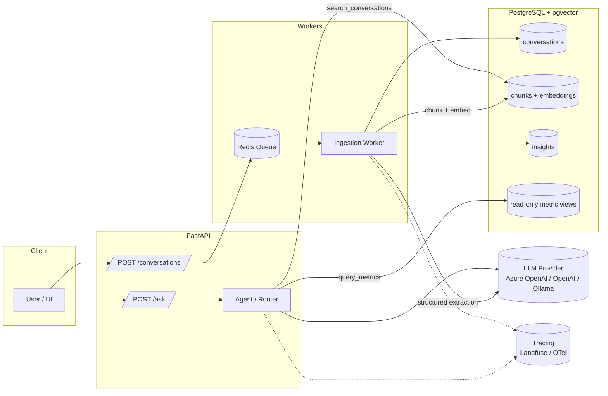

# VOC Copilot

> Conversational analytics over customer service interactions. Ask questions in plain language and get answers grounded in real conversations and metrics, with citations.


VOC Copilot ingests customer service transcripts (chat and voice), extracts structured insights with an LLM, and exposes an agent that answers questions like:

- *"Why did cancellations spike in September?"*
- *"What are the top 5 complaints about billing this month, with examples?"*
- *"Which competitors are mentioned most often by customers who churned?"*

The agent combines **RAG over conversations** (the *why*) with **text-to-SQL over metrics** (the *how much*), and every answer cites the source conversations.

All data in this repository is **synthetic**, generated by the built-in data generator.

> **Status:** early development. Phases 0–7 are done: foundation, synthetic data generator, ingestion (chunking, embeddings, insight extraction, real LLM providers), hybrid retrieval, guarded text-to-SQL, the tool-using agent behind `/v1/ask` with verified citations and SSE progress streaming, and OpenTelemetry tracing with per-request cost. Real-model eval numbers are pending an API key; see the [roadmap](docs/roadmap.md) for what is built and what is next. Sections below describe the target design.

---

## Table of contents

- [Features](#features)
- [Architecture](#architecture)
- [Project structure](#project-structure)
- [Getting started](#getting-started)
- [API overview](#api-overview)
- [Evaluation](#evaluation)
- [Design decisions](#design-decisions)
- [Roadmap](#roadmap)

---

## Features

- **Synthetic data generator** – realistic customer service conversations per industry (telecom, banking, e-commerce), with intent, sentiment, and resolution labels.
- **Async ingestion pipeline** – uploads are queued and processed by workers: chunking, embeddings, and structured extraction with schema-validated LLM output.
- **Hybrid retrieval** – BM25 (PostgreSQL full-text search) + vector search (pgvector), fused with Reciprocal Rank Fusion and reranked.
- **Tool-using agent** – routes each question to `search_conversations`, `query_metrics`, or both, and composes a grounded answer with citations.
- **Safe text-to-SQL** – queries run against read-only views, with a validated allowlist of tables and a statement timeout.
- **Pluggable LLM providers** – Azure OpenAI, OpenAI, or Ollama (local) through one OpenAI-compatible implementation; chat and embeddings can use different providers.
- **Evaluation suite** – retrieval metrics (recall@k, MRR) and answer metrics (faithfulness, answer relevance) running in CI.
- **Observability** – OpenTelemetry traces for every request, agent step, tool call, model call and ingestion job (GenAI semantic conventions, exported over OTLP to Jaeger, Langfuse, Tempo…); token usage and estimated cost per request and per job; `trace_id` in logs and responses.
- **Streaming** – answers streamed via Server-Sent Events.

---

## Architecture



### Ingestion flow

1. Client uploads up to 500 conversations per request to `POST /v1/conversations`. Customer records (plan, churn) go to `PUT /v1/customers`.
2. The API upserts by `external_id` and compares a content hash. New or changed conversations are saved, a job is created, and the response is `202 Accepted` with a `job_id`. Re-uploading unchanged, already-processed data returns `200` and does nothing.
3. An arq worker picks the job, splits each conversation into turn-aware chunks with speaker labels, and embeds them in batches.
4. The worker then calls the LLM for **structured extraction** (contact reason, sentiment, resolution, competitor mentions, churn risk, summary). The output schema is built per industry, with the contact reason as an enum of that industry's taxonomy, so the model can't invent categories. Each insight stores the extractor version (prompt + taxonomy hash) and the model.
5. Steps are tracked separately and are idempotent: a failed extraction keeps the chunks, and a retry only redoes what is missing. Transient errors retry the whole job with backoff; on the last attempt, failing conversations are recorded and the job ends as `partial`.
6. Chunks (with `tsvector` for keyword search and an HNSW index for vectors) and insights are written to PostgreSQL. Job status is exposed at `GET /v1/jobs/{job_id}`.

### Question-answering flow

1. Client sends a question to `POST /ask` (optionally streamed).
2. The agent plans which tools to call:
   - `search_conversations` → hybrid retrieval + reranking over chunks.
   - `query_metrics` → generates SQL against read-only views, validates it, executes it.
3. The LLM composes the final answer using only retrieved evidence, citing `conversation_id`s.
4. The full trace (tool calls, tokens, latency, cost) is recorded.

---

## Project structure

```text
voc-copilot/
├── app/
│   ├── main.py                     # FastAPI app factory, lifespan, routers
│   ├── core/
│   │   ├── config.py               # Settings (pydantic-settings)
│   │   ├── logging.py              # Structured logging (+ trace ids)
│   │   ├── middleware.py           # Request id + access log (pure ASGI)
│   │   └── security.py             # API key auth
│   ├── api/
│   │   ├── deps.py                 # Shared dependencies (db session, providers)
│   │   └── v1/
│   │       ├── conversations.py    # POST /conversations, GET /conversations/{id}
│   │       ├── jobs.py             # GET /jobs/{id}
│   │       ├── ask.py              # POST /ask (+ SSE streaming)
│   │       ├── insights.py         # GET /insights (aggregations)
│   │       └── health.py           # /health, /ready
│   ├── schemas/                    # Pydantic request/response models
│   │   ├── conversation.py
│   │   ├── insight.py
│   │   └── ask.py
│   ├── db/
│   │   ├── session.py              # Async SQLAlchemy engine/session
│   │   ├── models.py               # ORM models
│   │   └── views.sql               # Read-only views exposed to text-to-SQL
│   ├── llm/
│   │   ├── base.py                 # LLMProvider / EmbeddingProvider protocols
│   │   ├── openai_compatible.py    # OpenAI, Azure OpenAI and Ollama (one client API)
│   │   ├── fake.py                 # Deterministic providers for tests/offline
│   │   └── factory.py              # Provider selection from settings
│   ├── ingestion/
│   │   ├── chunking.py             # Turn-aware chunking
│   │   ├── pipeline.py             # Chunk + embed + extract steps (idempotent)
│   │   ├── service.py              # Idempotent upload, job creation
│   │   ├── extraction.py           # Structured insight extraction
│   │   ├── taxonomy.yaml           # Contact reasons per industry
│   │   └── prompts/
│   │       └── extract_insights.md
│   ├── observability/
│   │   ├── tracing.py              # OpenTelemetry setup, GenAI spans, trace ids
│   │   ├── usage.py                # Per-request usage meter and cost
│   │   └── prices.yaml             # USD per 1M tokens (verify; override with PRICES_FILE)
│   ├── analytics/
│   │   ├── catalog.py              # Views text-to-SQL may read, with column docs
│   │   ├── sql_guard.py            # sqlglot: one SELECT, allowed views + functions, LIMIT
│   │   ├── executor.py             # READ ONLY tx, statement timeout, analytics role
│   │   ├── text_to_sql.py          # Question -> SQL -> rows, one repair round
│   │   └── prompts/
│   │       └── text_to_sql.md
│   ├── answering/
│   │   ├── rag.py                  # Retrieve -> numbered sources -> cited answer
│   │   ├── citations.py            # Citation must quote its source verbatim
│   │   └── prompts/
│   │       └── answer.md
│   ├── retrieval/
│   │   ├── types.py                # SearchFilters, RetrievedChunk
│   │   ├── retriever.py            # Strategy: vector | keyword | hybrid, + rerank
│   │   ├── vector.py               # pgvector search, filters, iterative HNSW scan
│   │   ├── keyword.py              # PostgreSQL full-text search (OR of stemmed terms)
│   │   ├── fusion.py               # Reciprocal Rank Fusion
│   │   └── rerank.py               # LLM reranking (graded relevance, one call)
│   ├── agent/
│   │   ├── orchestrator.py         # Tool-calling loop (no framework), citation checks
│   │   ├── tools.py                # search_conversations, query_metrics, final_answer
│   │   └── prompts/
│   │       └── system.md
│   └── workers/
│       ├── queue.py                # JobQueue protocol + arq implementation
│       ├── settings.py             # arq worker settings
│       └── tasks.py                # process_ingestion_job (retry policy)
├── synthetic/
│   ├── generator.py                # CLI: simulate labels, render text, write dataset
│   ├── scenarios.yaml              # Industries, contact reasons, outcomes, dated events
│   ├── schema.py                   # Config and output models
│   ├── simulation.py               # Samples ground-truth labels (who, when, why, outcome)
│   ├── render.py                   # Template and LLM renderers + label/text consistency check
│   ├── prompts/
│   │   └── conversation.md
│   └── datasets/                   # Small committed datasets for tests and evals
├── evals/
│   ├── datasets/
│   │   └── golden_questions.jsonl  # Questions + expected sources/answers
│   ├── metrics.py                  # Accuracy, macro-F1, set precision/recall
│   ├── extraction_eval.py          # Extraction vs. ground truth, per field
│   ├── reports/                    # Committed eval reports
│   ├── retrieval_eval.py           # recall@k, MRR
│   └── answer_eval.py              # faithfulness, relevance (LLM-as-judge)
├── migrations/                     # Alembic migrations
│   ├── env.py
│   └── versions/
├── tests/
│   ├── conftest.py                 # Testcontainers Postgres, fake LLM provider
│   ├── unit/
│   │   ├── test_chunking.py
│   │   ├── test_fusion.py
│   │   └── test_sql_guard.py
│   └── integration/
│       ├── test_ingestion.py
│       └── test_ask.py
├── scripts/
│   └── ingest.py                   # Upload a generated dataset and wait for jobs
├── docs/
│   ├── architecture.md
│   ├── adr/                        # Architecture Decision Records
│   │   ├── 0001-pgvector-over-dedicated-vector-db.md
│   │   ├── 0002-no-agent-framework.md
│   │   └── 0003-hybrid-retrieval.md
│   └── images/
├── .github/
│   └── workflows/
│       ├── ci.yml                  # Lint, type-check, tests
│       └── evals.yml               # Run evals, post report on PR
├── docker-compose.yml              # api, worker, postgres (pgvector), redis, langfuse
├── Dockerfile
├── Makefile
├── pyproject.toml                  # uv / ruff / mypy / pytest config
├── .env.example
├── LICENSE
└── README.md
```

---

## Getting started

### Prerequisites

- Docker and Docker Compose
- [uv](https://github.com/astral-sh/uv) (for local development)
- An API key for Azure OpenAI or OpenAI, **or** [Ollama](https://ollama.com) running locally. Not needed yet: `LLM_PROVIDER=fake` runs fully offline.

### 1. Configure

```bash
cp .env.example .env
```

The defaults work out of the box. See [`.env.example`](.env.example) for every setting, including LLM provider credentials.

### 2. Run

```bash
make up        # docker compose up: postgres, redis, migrations, api
curl localhost:8000/ready
# {"status":"ok","checks":{"postgres":"ok","redis":"ok"}}
```

For local development with hot reload, run only the dependencies in Docker:

```bash
make install
docker compose up -d postgres redis
make migrate
make dev
```

### 3. Generate synthetic data

```bash
make generate INDUSTRY=telecom N=500 SEED=42
# -> data/telecom-seed42-n500/{conversations,ground_truth,customers}.jsonl + manifest.json
```

The generator first samples **labels** (contact reason, outcome, sentiment, churn, competitor mentions, and which dated event is behind the contact), then writes text that matches them. Labels are the ground truth for evals and are kept in a separate file from the conversations the API ingests. Events are injected on purpose: in the telecom scenario a price increase on Sep 1 roughly doubles billing complaints and churn, and a network outage on Oct 14–16 multiplies technical contacts, so questions like *"why did cancellations spike in September?"* have a known answer.

Text comes from phrase banks by default (offline, byte-for-byte reproducible). `RENDERER=llm` uses the configured LLM provider and validates every conversation against its labels, retrying with feedback when they disagree. `make seed` generates and ingests in one step (the stack must be running).

### 4. Ask a question

```bash
curl -X POST http://localhost:8000/v1/ask \
  -H "X-API-Key: change-me" \
  -H "Content-Type: application/json" \
  -d '{"question": "Why are customers upset about their bills?", "industry": "telecom",
       "start": "2026-09-01T00:00:00Z", "end": "2026-10-01T00:00:00Z"}'
```

`/v1/ask` runs the agent:
- It picks `query_metrics` for "how much", `search_conversations` for "why", or both, and turns "in September" into filters itself.
- It finishes through a `final_answer` tool whose citations are verified against what it actually retrieved: quotes must appear verbatim in a retrieved excerpt, and metric references must exist.
- With `?stream=true` it sends server-sent events while it works (`tool_start`, `tool_end`), then the full `answer`.
- `"mode": "rag"` runs the plain single-search RAG instead, for comparison.

Interactive docs: http://localhost:8000/docs

### Useful commands

| Command          | Description                                          |
|------------------|------------------------------------------------------|
| `make up`        | Start the full stack (runs migrations first)         |
| `make up-observability` | Same, plus Jaeger for traces at http://localhost:16686 |
| `make dev`       | Run API with hot reload                              |
| `make migrate`   | Apply Alembic migrations                             |
| `make test`      | Unit + integration tests (Testcontainers)            |
| `make test-unit` | Unit tests only, no Docker needed                    |
| `make lint`      | Ruff lint + format check                             |
| `make typecheck` | mypy (strict)                                        |
| `make check`     | Everything CI runs                                   |
| `make worker`    | Run the ingestion worker locally                     |
| `make generate`  | Generate a synthetic dataset                         |
| `make dataset`   | Regenerate the committed test/eval dataset           |
| `make seed`      | Generate a dataset and ingest it into the API        |
| `make eval-extraction` | Score extraction against ground truth (needs a real LLM) |
| `make golden`    | Rebuild the retrieval golden set from ground truth   |
| `make eval-sql`  | Text-to-SQL execution accuracy (needs a real LLM)    |
| `make eval-agent`| Agent routing, citation validity, faithfulness (needs a real LLM) |
| `make eval-retrieval` | Score retrieval on the golden set (data must be ingested); `ARGS="--strategy keyword"` |

Integration tests start throwaway Postgres (pgvector) and Redis containers. Without Docker, point them at existing instances with `TEST_DATABASE_URL` and `TEST_REDIS_URL`.

---

## API overview

| Method | Endpoint                    | Description                                   |
|--------|-----------------------------|-----------------------------------------------|
| POST   | `/v1/conversations`         | Upload conversations (returns `job_id`)       |
| GET    | `/v1/conversations/{external_id}` | Conversation, processing status, chunk count |
| PUT    | `/v1/customers`             | Upsert customer records (plan, churn)         |
| POST   | `/v1/metrics`               | Quantitative question → guarded SQL → rows    |
| GET    | `/v1/jobs/{id}`             | Ingestion job status                          |
| POST   | `/v1/ask`                   | Ask a question (`?stream=true` for SSE)       |
| GET    | `/v1/insights`              | Aggregated insights by period / reason        |
| GET    | `/health`, `/ready`         | Liveness and readiness probes                 |

Example response from `/v1/ask` (abridged):

```json
{
  "answer": "Churn more than tripled in September (55 customers vs. 15 in August) [M1]. Customers tie them to the unannounced price increase [S1][S3]...",
  "mode": "agent",
  "tools_used": ["query_metrics", "search_conversations"],
  "citations": [
    {"conversation_id": "conv_telecom_000301", "excerpt": "My bill went up from $49.90 to $57.38 and nobody told me"},
    {"conversation_id": "conv_telecom_000317", "excerpt": "I never got any notice about this price change"}
  ],
  "metrics": [
    {"id": "M1", "sql": "SELECT DATE_TRUNC('MONTH', churned_at) AS month, COUNT(*) AS churned FROM analytics.customers ...",
     "columns": ["month", "churned"], "rows": [["2026-08-01T00:00:00+00:00", 15], ["2026-09-01T00:00:00+00:00", 55]]}
  ],
  "steps": 3,
  "trace": [{"step": 1, "tool": "query_metrics", "summary": "[M1] Churned customers per month", "duration_ms": 1240}, "..."],
  "dropped_citations": 0,
  "usage": {
    "input_tokens": 6120, "output_tokens": 512, "latency_ms": 4840, "cost_usd": 0.0012,
    "by_model": [
      {"provider": "openai", "model": "gpt-4o-mini-2024-07-18", "kind": "chat", "calls": 4, "input_tokens": 6100, "output_tokens": 512, "cost_usd": 0.001222},
      {"provider": "openai", "model": "text-embedding-3-small", "kind": "embedding", "calls": 1, "input_tokens": 20, "output_tokens": 0, "cost_usd": 0.0000004}
    ]
  },
  "trace_id": "fca41bf4d6b3006873beef4b66bd718d"
}
```

---

## Evaluation

Evals run on every pull request and post a summary as a comment *(phase 8; for now they run locally)*.

| Metric             | What it measures                                        |
|--------------------|---------------------------------------------------------|
| Extraction accuracy / macro-F1 | Extracted reason, sentiment, resolution, churn risk match ground truth |
| Competitor P/R     | Competitors mentioned are found, and none are invented  |
| Recall@k           | Expected source conversations appear in the top-k       |
| MRR                | How high the first relevant result ranks                |
| Faithfulness       | Claims in the answer are supported by retrieved context |
| Routing accuracy   | The agent used every tool the question needs (18 questions) |
| Citation validity  | Citations that verify against retrieved excerpts         |
| SQL accuracy       | Generated SQL returns the same result as a reference query (execution accuracy, 18 questions) |

**Extraction** (`make eval-extraction`, 200 conversations from `telecom-seed42-n500`, compared with a majority-class baseline): *pending a run with a real provider.*

**Retrieval** (`make eval-retrieval`). The golden set has 45 questions derived from ground truth (`evals/build_golden.py`): contact reason per month, competitor mentions, injected events, and churn per month, each with search filters and the set of relevant conversations. The scores below are means over questions at k = 10; recall is normalized by min(k, |relevant|).

| Retrieval strategy | Embeddings | MRR@10 | Precision@10 | Recall@10 | Report |
|--------------------|------------|-------:|-------------:|----------:|--------|
| Vector only | hashed bag-of-words (offline) | 0.387 | 0.240 | 0.268 | [link](evals/reports/retrieval-golden-telecom-seed42-n500-vector-fake-embedding.md) |
| Keyword only | – (Postgres full-text) | **0.826** | **0.656** | **0.768** | [link](evals/reports/retrieval-golden-telecom-seed42-n500-keyword-fake-embedding.md) |
| Hybrid (RRF) | hashed bag-of-words (offline) | 0.722 | 0.520 | 0.594 | [link](evals/reports/retrieval-golden-telecom-seed42-n500-hybrid-fake-embedding.md) |
| Vector / Hybrid | `text-embedding-3-small` | – | – | – | pending API key |
| Hybrid + LLM rerank | `text-embedding-3-small` | – | – | – | pending API key |

What these numbers say, and what they don't:

- **Keyword wins on this dataset.** The transcripts are template-rendered and the golden questions reuse their vocabulary, which flatters keyword search.
- **Hybrid loses to keyword here** because the offline "embeddings" are a weak lexical ranking that RRF weighs equally with the strong one. That says nothing yet about hybrid with real embeddings, which is what [ADR 0003](docs/adr/0003-hybrid-retrieval.md) is about.
- **The default is still `hybrid`.** Keyword-only search returns nothing for questions that share no words with the conversations ("What about prices?" vs. "my bill went up"), and this golden set doesn't measure that case. Set `RETRIEVAL_STRATEGY` and `RETRIEVAL_RERANK` to change it.

---

## Design decisions

Full reasoning in [`docs/adr/`](docs/adr/). Phase-by-phase plan in [`docs/roadmap.md`](docs/roadmap.md).

- **pgvector instead of a dedicated vector database.** Vectors, metadata, and metrics live in one transactional store, which simplifies joins between semantic search and structured filters. A dedicated vector DB would only pay off at a scale this project doesn't target.
- **No agent framework.** The orchestration loop is a few hundred lines of explicit code: easier to debug, test, and trace. Providers are abstracted behind small protocols, so a framework can be added later without touching business logic.
- **Hybrid retrieval.** Customer service text is full of product names, plan codes, and error messages where keyword search beats embeddings; semantic search handles paraphrased complaints. RRF combines both without score calibration.
- **Async ingestion via queue.** LLM extraction is slow and rate-limited; the queue isolates API latency from processing time and allows retries with backoff.
- **Read-only views for text-to-SQL.** The model never touches base tables. Queries are parsed, checked against allowlists of views and functions, limited, and executed in a read-only transaction with a statement timeout as a role that can only read the views. Each layer has adversarial tests that bypass the others ([ADR 0007](docs/adr/0007-guarded-text-to-sql.md)).
- **Synthetic data first.** Real customer data carries PII and contractual restrictions. The generator makes the project fully reproducible.

---

## Roadmap

- [x] Foundation: tooling, compose stack, health checks, migrations, CI
- [x] Synthetic data generator with ground-truth labels and injected events
- [x] Ingestion, insight extraction, real LLM providers
- [x] RAG with verified citations; hybrid retrieval + reranking
- [x] Text-to-SQL tool with SQL guard
- [x] Tool-using agent with SSE progress streaming
- [ ] Eval numbers with a real model (needs an API key)
- [ ] Eval suite in CI
- [x] Tracing (OpenTelemetry) and cost tracking
- [ ] PII redaction step before embedding
- [ ] Multi-tenant support (row-level security)
- [ ] React UI with shadcn/ui: chat with streamed answers and clickable citations, insights dashboard
- [ ] Deploy guide (Azure Container Apps)

---

## License

MIT
